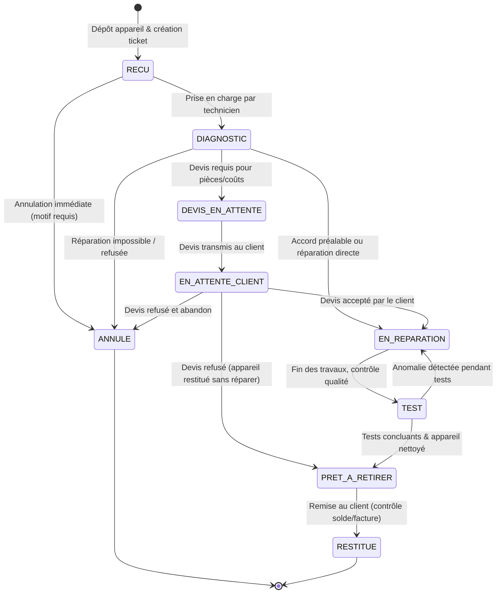

# Cycles de Vie & Workflows Métier — RepairOS

---

## 1. Machine à États du Ticket de Réparation (`RepairTicket`)

Le cycle de vie complet suit la chaîne :
**RECU → DIAGNOSTIC → DEVIS_EN_ATTENTE → EN_ATTENTE_CLIENT → EN_REPARATION → TEST → PRET_A_RETIRER → RESTITUE** (avec possibilité de bifurcation vers **ANNULE**).

### Règles d'Intégrité et de Garde (Guards)

1. **Garde de Restitution (`RESTITUE`) :**
   - Un ticket ne peut passer au statut `RESTITUE` que si les conditions fixées par l'atelier sont vérifiées :
     - Soit le solde financier de la facture est nul (ou expressément dérogé par un OWNER/ADMIN avec enregistrement d'une note de créance).
     - La signature ou l'accusé de réception est noté.
     - L'horodatage `closed_at` est automatiquement fixé à l'instant présent UTC.

2. **Garde d'Annulation (`ANNULE`) :**
   - Un motif d'annulation explicite (`reason`) de minimum 10 caractères est obligatoire.
   - Si des paiements ou factures ont déjà été émis, ils doivent être soldés ou faire l'objet d'un avoir/annulation comptable contrôlée.

3. **Traçabilité Immuable (`RepairStatusHistory`) :**
   - Chaque appel à `transitionTo($newStatus, $userId, $reason)` enregistre une ligne dans `repair_status_histories`.

---

## 2. Cycle de Vie du Devis (`Quote`)

Statuts autorisés :
- `BROUILLON` (Modifiable : ajout/suppression de lignes, remises)
- `ENVOYE` (Verrouillé en lecture : date de transmission enregistrée)
- `ACCEPTE` (Verrouillé permanent : déclenche le passage du ticket en `EN_REPARATION`)
- `REFUSE` (Verrouillé avec motif obligatoire)
- `EXPIRE` (Si la date de validité `valid_until` est dépassée)
- `ANNULE` (Annulation manuelle par l'atelier)

---

## 3. Cycle de Vie de la Facture & Encaissements (`Invoice` & `Payment`)

1. **Émission de la Facture :**
   - Créée à partir du devis validé ou directement des travaux effectués.
   - Les totaux sont recalculés et figés (`subtotal_amount`, `tax_amount`, `total_amount`).
   - `paid_amount` démarre à `0.00`, `balance_due` = `total_amount`.
   - Statut initial : `EMISE`.

2. **Enregistrement de Paiements (Partiels ou Total) :**
   - À chaque encaissement : `paid_amount += payment.amount` et `balance_due = total_amount - paid_amount`.
   - Si `balance_due == 0` : le statut devient `PAYEE`.
   - Si `0 < balance_due < total_amount` : le statut devient `PARTIELLEMENT_PAYEE`.
   - Un reçu avec référence unique `REC-xxxx` est immédiatement disponible.

3. **Devise et Arrondis :**
   - La devise par défaut est le Franc CFA (`XOF`), monnaie sans décimales fractionnaires en circulation courante.
   - Les calculs acceptent la précision à 2 décimales pour conformité comptable stricte, avec formatage monétaire net pour l'utilisateur (`15 000 FCFA`).
